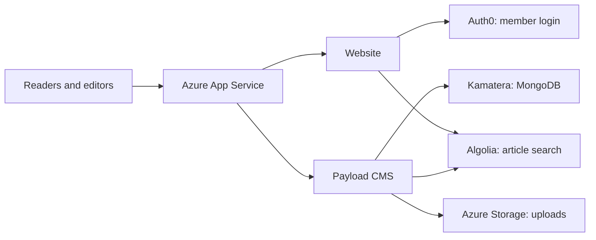

# USTW engineering and operations

Start here when joining or maintaining the project. These instructions are in the USTW GitHub repository so engineers can use them from their own computers. Nothing requires a copy of Jerry's local workspace.

## Where the website runs

| Component | Production location / source |
| --- | --- |
| Website | Azure `ustw-cms-frontend-dev`; source: [website repository](https://github.com/US-Taiwan-Watch/website) |
| CMS | Azure `ustw-cms-backend`; source: [payload3/](../payload3/README.md) in this repository |
| Database | Kamatera Seattle, `ustw-db-prod`, `45.61.62.229`; MongoDB 9.0.4 on Ubuntu 26.04.1 LTS, verified November 3, 2026 |
| Uploaded images and private files | Existing Azure Storage account `ustwcmsstorage`; private submissions use `ustw-taiwan-records-private-v3` |
| Supporting services | Auth0 member login, Algolia search, SoundOn podcasts; runtime settings remain in Azure |
| Monitoring / scheduled maintenance | [Azure monitor](azure-monitoring/README.md), [database certificates](mongodb-certificates/README.md), [media backups](recovery/README.md) |

**The apex, www and dev domains share production.** `ustw.watch`, `www.ustw.watch` and `dev.ustw.watch` use the same deployed website and CMS. The frontend app name and GitHub environment name `Development` are historical names; neither identifies an isolated test environment.

The CMS runs Payload 3.92.1. MongoDB uses authenticated TLS and a single-member `ustw-rs0`; its firewall restricts database connections to the backend. An engineer's computer is not a production component.

## Where to find information and access

| Need | Team-accessible destination |
| --- | --- |
| Source and engineering instructions | This repository and the website repository; clone them using your own GitHub access |
| Build, deploy and roll back | [Website deployment guide](https://github.com/US-Taiwan-Watch/website/blob/main/deployment/README.md) and its GitHub Actions runs |
| Current runtime configuration | Azure → resource group `ustw-cms-rg` → the relevant App Service → configuration/environment variables; use authorized Azure access |
| Service accounts and recovery credentials | USTW Notion → Teams Wiki Archieve → [Service 帳密資訊](https://www.notion.so/2e449272635e4867afeb7ed843bf9730); recovery keys and admin instructions are under **Production recovery kit** |
| Existing service reference | [Azure DevOps → Service Information](https://dev.azure.com/ustw/US%20Taiwan%20Watch/_wiki/wikis/US-Taiwan-Watch.wiki/11/Service-Information); check current Notion/Azure records when old entries disagree |
| Live maintenance status | Database host service/status paths in the three guides linked above; Azure alert notifications go to `contact@ustw.watch` |

Ask an existing USTW administrator for the required repository, Azure, Kamatera and Notion access. Sign in with your own account. Do not copy another operator's browser/CLI session or commit service secrets. SSH access/recovery instructions are in the protected Notion kit.

## Deploying and checking a release

1. Review source changes. Website features go to `develop`; promote to `main` with a **merge commit**, then align develop without force-pushing. Backend changes go to `master`.
2. Follow the website deployment guide: manually build reviewed images from main, then manually deploy exact immutable digests. Merging a PR does not deploy production.
3. Confirm the deployment checks and the feature changed by the release. A failed deployment attempts to restore the previous images and verifies their health.

GitHub signs in to Azure using OIDC, scoped to the two apps. An engineer does not need Jerry's local Azure CLI installation or sign-in cache to run an authorized GitHub deployment.

| Verified November 3, 2026 | Shared evidence |
| --- | --- |
| Deployment connection and branch-history repair | [Website PR #232](https://github.com/US-Taiwan-Watch/website/pull/232) |
| Normal production deployment | [Successful workflow run](https://github.com/US-Taiwan-Watch/website/actions/runs/41653454559) |
| Real automatic rollback | [Supervised drill](https://github.com/US-Taiwan-Watch/website/actions/runs/41652639876); deliberately failed after deployment, then restored both exact starting images and passed restored-health checks |

Image rollback does not restore database records or uploaded files. Never run the legacy Payload 2 backend against migrated MongoDB 9 data. The old database server at `83.229.67.82` remains preserved; retirement needs a separate dependency/cost review.

## Backup coverage

| Data | Existing recovery location | Instructions |
| --- | --- | --- |
| Source | GitHub version history | Repositories above |
| Database and Linux server | Kamatera **Full Daily Backup** for `USTW-DB-PROD` | Kamatera console → Servers → Configure; whole-server restoration has not been exercised |
| Logical database export | Database host `/var/backups/ustw-mongodb/`; daily 08:00 UTC plus up to five minutes, 14 days | `ustw-mongodb-backup.timer` / `.service`; logical restoration already verified |
| Uploaded images/private files | Azure `ustwcmsstorage/ustw-recovery-backups-v1`; daily 08:15 UTC plus up to five minutes, 14 days | [Media restore guide](recovery/README.md); obtain the decryption key from Notion |

Azure copying is media only. It does not duplicate source or database backups. Actual database and media restores passed; media verification covered all 3,312 files. The media allowance is up to US$2/month in the existing account; no separate staging host or backup subscription is planned.

## Current priorities and local files

- Production modernization, deployment/rollback, alerts, certificate renewal and scheduled media backup are implemented. Prioritize website bugs and feature improvements.
- Bill/people automatic updates and newsletters remain disabled by user decision.
- Registrar/DNS ownership, some service billing/legal ownership and old-server retirement are later administrative work.
- This owner's USTW ChatGPT space is a project dashboard; team access is not configured. It is not a required engineering entry point.
- `local-operations` on Jerry's Mac contains optional tools, operator sign-in caches and historical working records. It is not shared, is not part of deployment and is not the team's documentation or credential store. Do not publish that folder or rely on its files for onboarding.
