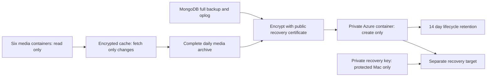

# Database and media recovery

Daily encrypted recovery copies use the existing `ustwcmsstorage` account,
private container `ustw-recovery-backups-v1`. No new hosting plan is required.
The old database server remains an untouched rollback resource.



| Item | Configuration |
|---|---|
| Database host | `ustw-db-prod`, `45.61.62.229` |
| Schedule | `ustw-recovery.timer`: 08:15 UTC daily plus up to 5 minutes; persistent missed-run handling |
| Service | `ustw-recovery.service`; first creates a fresh full database/oplog backup |
| Resource limits | Idle I/O, low priority, 50% CPU quota, 1 GB memory, one-hour timeout |
| Cloud format | `daily/<UTC timestamp>/database.archive.gz.cms`, `media.tar.cms`, `receipt.json.cms` |
| Encryption | CMS AES-256-GCM; RSA-4096 OAEP/SHA256 recipient; authentication checked before publishing decrypted files |
| Local state | `/var/lib/ustw-recovery/`, root only; media cache contains individually encrypted files |
| Credentials | `/etc/ustw-recovery/config.json`, root/0600; read/list for six source containers, create-only for destination; HTTPS and server-IP restricted |
| Key | **No private decryption key on the database server or in Azure.** Public recipient certificate only |
| Expiration | Backup access expires November 2, 2027 UTC; health fails at 30 days remaining. Renew before October 3, 2027 |
| Retention | Lifecycle delete after 14 days, restricted to this container; Azure deletion is asynchronous |
| Alerts | Existing production health alert: backup failed or older than 30 hours, inactive timer, or credentials within 30 days of expiry |

Each day's media archive is self-contained. Cached objects are reused locally,
but complete encrypted copies go into every daily archive; deleting an older
archive cannot break a newer restore. ETags and a second source inventory reject
media changes during copying. File bytes, original names, container mappings,
content properties and metadata are retained. Database and media are captured
consecutively, not as a cross-service transaction; inspect their timestamps when
selecting a recovery point. There may be up to one day's changes since the last
successful backup.

## Restore without touching production

1. Stop deployment/background writers **only when an actual recovery switch is
   approved**. Download the three files from one successful timestamp into a
   protected recovery directory. Obtain the private recipient key separately.
2. Decrypt `receipt.json.cms` using `seal.py decrypt`, verify its certificate
   fingerprint and SHA256 values against the downloaded database/media files.
3. Decrypt the database archive using `seal.py decrypt`. Verify the plaintext
   SHA256 against the receipt. Restore with MongoDB 9 tools, `--gzip --oplogReplay`,
   into a **new isolated database**, never the running production instance.
   A full archive includes database users/roles; recovery must account for them.
4. Restore media with the command below. It checks every encrypted and plaintext
   SHA256, refuses archive path traversal and writes only safe opaque filenames.
   `manifest.json` maps those files back to original container/blob names and
   HTTP properties. Verify in **new private containers** before any production
   replacement; private uploads must remain private.
5. Check application data/index counts and affected pages/media; agree the
   recovery point, then perform a separately authorized production switch.
   Remove temporary decrypted copies and disposable targets afterward.

```sh
python3 seal.py decrypt --source receipt.json.cms --output receipt.json \
  --certificate recipient.crt --private-key recipient.key
python3 seal.py decrypt --source database.archive.gz.cms --output database.archive.gz \
  --certificate recipient.crt --private-key recipient.key
python3 restore_media.py --archive media.tar.cms --output media-restored \
  --certificate recipient.crt --private-key recipient.key
```

Use a protected directory (0700), `umask 077`, and protected credential files;
never put passwords or SAS URLs in command arguments, logs, source, or Pages.

## Cost controls

The user approved **up to US$2/month**, including backup storage/operations.
Archive aggregation avoids thousands of daily cloud writes. The worker stops
and alerts before exceeding 800 MB total media, 4,000 files, 10 MB database,
830 MB per uploaded archive, 100 MB new/changed source downloads per subsequent
day, or 5 GB source downloads per calendar month. Initial cache fill can fetch
up to 800 MB. Usage is reserved before downloads, including failed attempts.
No automatic retries or paid upgrades are enabled. A successful day's manual
rerun skips uploading another copy.

At the November 2 prices, current ~705 MB media produces roughly 10 GB of
retained archives: approximately $0.59/month storage plus geo-replication,
small operations, and source-change transfers. The configured bounds leave
headroom below $2 at these rates even without assuming free internet egress.
This is an estimate, **not a hard Azure billing cap**; delayed lifecycle deletion,
taxes, pricing changes or unrelated account use can affect the bill. The free
account-wide budget warning includes existing production media costs too.

Prices: [Azure storage](https://azure.microsoft.com/en-us/pricing/details/storage/blobs/),
[bandwidth](https://azure.microsoft.com/en-us/pricing/details/bandwidth/),
[lifecycle behavior](https://learn.microsoft.com/en-us/azure/storage/blobs/lifecycle-management-policy-structure).

## Investigate an alert

Inspect `systemctl status ustw-recovery.service`, `journalctl -u
ustw-recovery.service`, and the root-only `/var/lib/ustw-recovery/status.json`.
An upload is recorded successful only after Azure accepts its validated
Content-MD5. The server credential cannot inspect or delete cloud backups;
use authorized Azure account access for independent verification and cleanup.
Correct a size/credential problem deliberately rather than increasing limits
or broadening permissions. Root-workspace leftovers are removed at the next
locked run; transient plaintext is removed on normal success/failure.

This protects against loss of the database host and accidental source media
changes/deletions within retention. It is not immutable protection against an
Azure account owner deleting backups, nor a whole-VM/provider-image restore
test. The private recovery key currently remains on the protected Mac; a
second controlled key copy is a separate custody follow-up.

## Installation reference

Python 3 and OpenSSL with CMS AES-GCM support are required. Install `backup.py`
and `seal.py` at `/usr/local/lib/ustw-recovery/`, `health.py` at
`/usr/local/libexec/ustw-recovery-health.py`, and the supplied units under
`/etc/systemd/system/`. Config/state directories are root/0700; real config is
root/0600. Replace the example SAS placeholders using only scoped HTTPS,
server-IP-restricted credentials; set their actual expiry epoch. Install only
the public recipient certificate on the server. Keep the real config out of
Git and never replace an existing private recipient key.

Run the service once, independently download and restore its output, then
enable the timer. Add `health.py`'s returned checks to the existing health
checker before the report's `passed` value is calculated. The monitor source
recognizes all three named backup checks. Current installation retains the
previous checker under `/root/ustw-provisioning/recovery-before/`.

For removal, first deliberately remove the backup-only health hook, then
disable only `ustw-recovery.timer`. Preserve the original MongoDB backup,
health/reporting/certificate timers, production data, encryption key and
already uploaded archives. Deleting recovery archives/container or changing
the shared account retention needs a separate recovery decision.

## Local checks

```sh
python3 -m unittest discover -s operations/recovery -p 'test_*.py' -v
```
